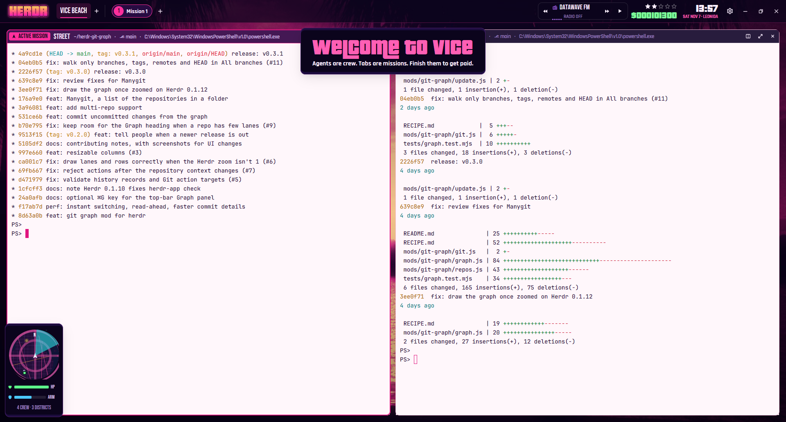
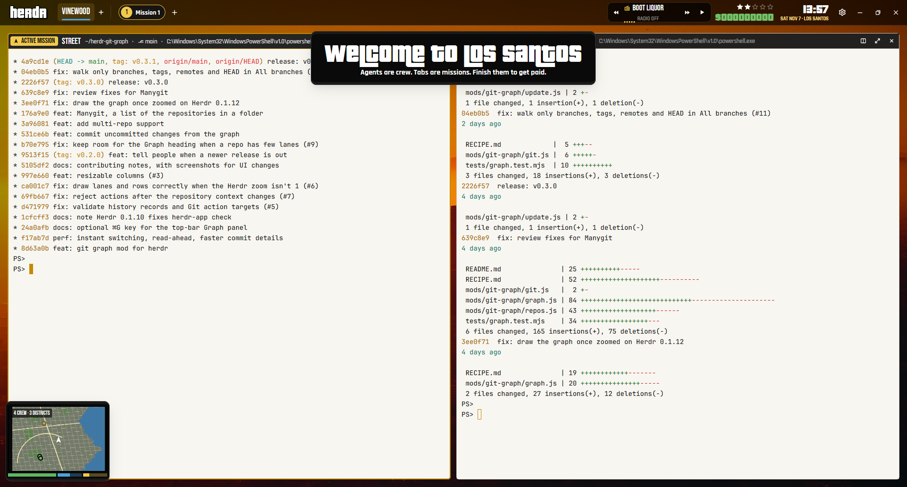
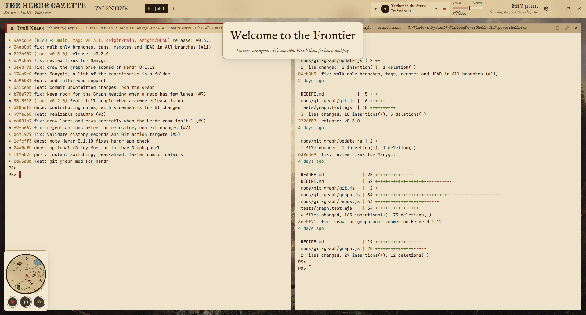

# Herdr layouts: GTA 6, GTA 5, RDR2

Three game-inspired layouts for the [Herdr app](https://herdr.dev). Each one is a whole window with its own HUD, minimap, mission banners and music.

| | |
|---|---|
| **[GTA 6](gta6/RECIPE.md)**: a neon Vice sunset. Districts, missions, wanted stars, a synthwave radio. |  |
| **[GTA 5](gta5/RECIPE.md)**: Los Santos smog sunset, a GTA V-style minimap with health, armor and special bars, and SomaFM radio. |  |
| **[RDR2](rdr2/RECIPE.md)**: 1899 frontier. A newspaper masthead, honor, WANTED posters, and a phonograph of public-domain records. |  |

## Add one

Tell your agent:

```
Read ~/.config/herdr-app/AGENTS.md, then add this layout: https://github.com/rafeehcp/herdr-layouts/tree/main/gta6
```

(or `gta5`, `rdr2`). Each folder has `layouts/`, `mods/` and `themes/`: copy all three into `~/.config/herdr-app/`. The music needs [FFmpeg](https://ffmpeg.org)'s `ffplay` on PATH.

## What they do

Agents are your crew. When an agent finishes, you get paid and a "mission passed" banner shows; a blocked agent sets off wanted stars or a WANTED poster. The music plays through `ffplay`, started as a hidden herdr-core terminal, and stops when you leave the layout. The radios stream free internet radio (nightride.fm, SomaFM). RDR2's phonograph plays local public-domain records. Nothing else reaches the network, and nothing reads files outside its own folder.

## Credits

Fan-made and unofficial: not affiliated with or endorsed by Rockstar Games. No Rockstar art is included.

- **Wallpapers:**
  - A public-domain Miami sunset (Wikimedia Commons, "Gfp-florida-miami-sunset.jpg").
  - "Tequila Sunset", CC0, from Unsplash via Wikimedia Commons.
  - Albert Bierstadt, *Among the Sierra Nevada, California* (1868), public domain.
- **Records:** public-domain recordings from Wikimedia Commons.
  - Eck Robertson & Henry Gilliland, *Arkansaw Traveler* (1922).
  - U.S. Marine Band, *Maple Leaf Rag* (1906).
  - *Turkey in the Straw*.
  - *Home on the Range*.
  - Scott Joplin, *Augustan Club Waltzes* (1901).
  - Melville Morris, *Kangaroo Hop* (1915).
- **Fonts:**
  - Bebas Neue, Rajdhani, Rye and IM Fell English: SIL Open Font License.
  - Special Elite: Apache 2.0.
  - Their licences sit next to them.
  - Pricedown (Typodermic) is used if you install it yourself; its licence doesn't allow redistribution.
- **Everything else:** logos, banners, maps, icons and sound effects were made for these layouts. MIT, see [LICENSE](LICENSE).
