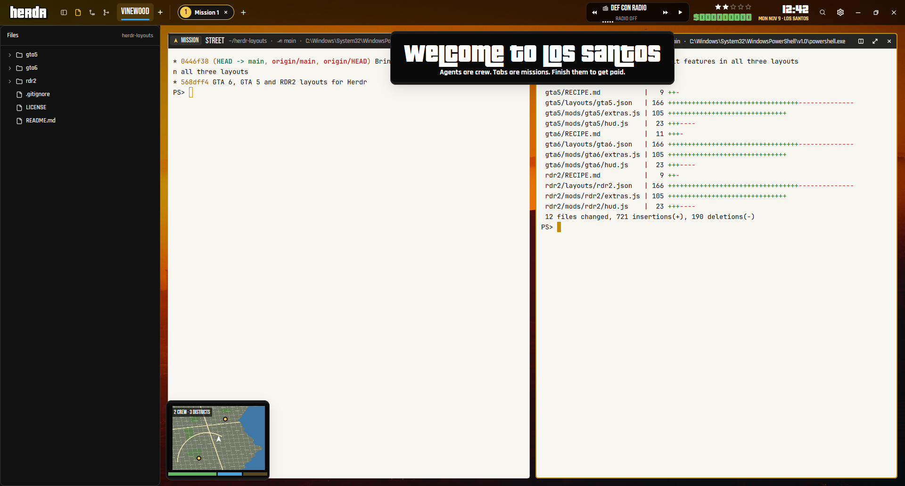

# GTA 5

A sunny Los Santos HUD for Herdr, inspired by GTA V. A smoggy orange sunset over downtown LA sits behind black-glass bars, with green money and a gold mission tag. A GTA V-style rectangular minimap has health, armor and special bars. Agents finishing pay out with "mission passed". Getting stuck shows "wanted", and dying mid-job shows "wasted". A radio streams eight free SomaFM stations.

Fan-made and unofficial. It contains no Rockstar art. The logo, banners, minimap and sounds were made for this layout, and the wallpaper is a CC0 photo.

## What you see

- **HUD, top, 54px**: `#000000` at 65% opacity over the wallpaper. It is a window-drag bar. From left to right:
  - **Logo:** `img/logo.png`, a white "herdr" with a black outline, 94×40.
  - **Districts:** one chip per space, Bebas Neue 19px.
    - The underlines take turns in the three switch colors: blue `#4aa3df`, green `#5fb760`, orange `#ff9a3d`. The active space's underline is solid; the others are faded.
    - A `+` makes a new space.
  - **Missions:** the active space's tabs as 32px pills, with a gold number circle when active and a status dot. A `+` opens Herdr's new-menu.
  - **Radio:** a station name, EQ bars and a status line. ⏮ and ⏭ change station, ▶/■ plays or stops, and scrolling changes the volume.
  - **Wanted stars:** five white stars, with cash under them (Pricedown, `#72c26a`).
  - **Clock:** with "SAT NOV 7 · LOS SANTOS" under it.
  - **Buttons:** Search (Herdr's picker), Settings (with a dot when an app update is ready), then minimize, maximize and close.
- **Panes**:
  - Pane frames: background `#f8f6f1f0`, radius 6, gap 12, padding 16, a 1px `#00000026` border, and a 2px `#c48a00` border when focused.
  - Terminals: JetBrains Mono 14 on warm off-white (`themes/gta5.json`).
- **Pane header, 32px**: the focused pane has a dark `#1a1a1af2` background with a gold "ACTIVE MISSION" chip. Then the program name ("STREET" for a shell), the folder, branch and title, a status badge, and split, zoom and close buttons.
- **Minimap** (floating, left edge, bottom):
  - A 210×140 rounded rectangle on its own black card. It shows an invented sunny coastal city: grey-green land, parks, blue ocean, pale freeways.
  - Agents are blips around the white arrow (you).
  - Under it are three bars, as in GTA V: health (green, wide), armor (blue) and special (gold).
- **Banner** (floating, top center): a black card with `img/passed.png` (gold "mission passed"), `img/wasted.png` (red), `img/wanted.png` (white on dark red), or "welcome to los santos".
- **Wallpaper:** "Tequila Sunset", a CC0 Unsplash photo from Wikimedia Commons of the downtown LA skyline in orange smog, given a teal-and-orange grade.

## How it behaves

- **Statuses and stars:** working is gold, blocked is red (flashing), done is green. Stars light up for working agents, and twice for each blocked agent, flashing red while anything is blocked.
- **Working → done:** the cash goes up by $5,000–75,000 (shared `gta5.cash`), `passed.mp3` plays, and "mission passed" shows with "+$N".
- **Blocked:** `wanted.mp3` plays and "wanted" shows.
- **An agent disappears while working:** `wasted.mp3` plays and "wasted" shows "<program> in <space> went down mid-job".
- **Radio:** stations are Fluid (instrumental hip-hop), Groove Salad, Left Coast 70s, Underground 80s, PopTron, Boot Liquor, Metal Detector and DEF CON Radio, from `https://ice1.somafm.com/<id>-128-mp3`. Settings are kept in shared `gta5.radio`. The radio starts on entering the layout unless you turned it off, and stops on leaving.
- **Clicks:** the same as GTA 6.
  - Districts select their space; missions select their tab. Middle-click a mission to close it; right-click for Herdr's tab menu.
  - Click a blip to focus that agent's pane.
  - Pane headers: double-click zooms, middle-click closes.

- **Herdr's default features:** the HUD keeps what Herdr's own sidebar and tab bar do.
  - After the logo: buttons that open a side panel on the left (340px, hidden at first): **Spaces & agents** (Herdr's `spaces` and `agents` lists, stacked: machines, worktrees, pin, peek, sort, sub-agents), **Files** and **Changes** (`hud-files` and `hud-changes`, see Watch out). Click the lit one again to close the panel.
  - Districts and missions: drag one onto another to reorder, double-click to rename, middle-click to close (no confirm), right-click for Herdr's space or tab menu.
  - The active mission has a × to close it, and a zoomed mission reads "· Z" after its name.
  - It's all in `mods/gta5/extras.js`, the same file in every layout of this repo.

## Built from

- **Layout `layouts/gta5.json`:** the same tree as GTA 6, with mod `gta5`. Roles: `hud`, `mission`, `radar`, `banner`. `theme: "gta5"`, `ui_font: "Rajdhani"`.
  - Under the HUD, a `work-body` row: a hidden `panel` column (a `panel-body` stack of `crew` [`spaces` + `agents` blocks], `files` (mod `hud-files`) and `changes` (mod `hud-changes`)), then `main`.
- **Mod `mods/gta5`:** `main.js` (roles), `hud.js`, `mission.js`, `radar.js`, `banner.js`, and `kit.js` (palette, `SWITCH` colors, SomaFM stations, cash).
- **Theme `themes/gta5.json`:** light terminals (`#f8f6f1`, including `colors.background`), with dark panels.
- **Programs:** `ffplay`, run as the herdr-core terminal `gta5-radio` (`hc run --bg --rm`, `hc kill`). It reaches the network only for the SomaFM streams.
- **Art:** Bebas Neue and Rajdhani (OFL). The PNGs and MP3s were made for this layout. The wallpaper is CC0.

## Watch out

- Copy `themes/gta5.json` too.
- Pricedown isn't included: its licence forbids redistribution. The live text falls back to Bebas Neue unless you install Pricedown into `mods/gta5/fonts/`.
- **ffplay must be on PATH.** On Windows it also tries winget's Links folder. SomaFM refuses curl's default user agent, but works with ffplay's.
- **Running GTA 6 alongside:** both mods are independent, with their own shared keys and radio terminals. Switching layouts stops one radio and starts the other.
- Floats are framed in the light terminal color, so the minimap and banner draw their own black card.

- **Files and Changes are copies.** Herdr's shipped `files` and `changes` paint the theme's `background` under its `foreground`. In the GTA themes, `background` is the light terminal color and `foreground` is the dark panels' light text, so those panels would be unreadable. `mods/hud-files` and `mods/hud-changes` are the shipped mods with one change: they paint `chrome` when those two colors are too close. Copy both folders into `mods/`. They're the same in every layout of this repo.

## Done when

- `herdr-app check mods/gta5` passes, and the layout shows the black HUD, the rectangular minimap with three bars, and the welcome banner.
- ▶ plays a SomaFM station, and `hc ls` shows `gta5-radio`.
- "mission passed", "wanted" and "wasted" show for done, blocked, and an agent closed mid-work.
