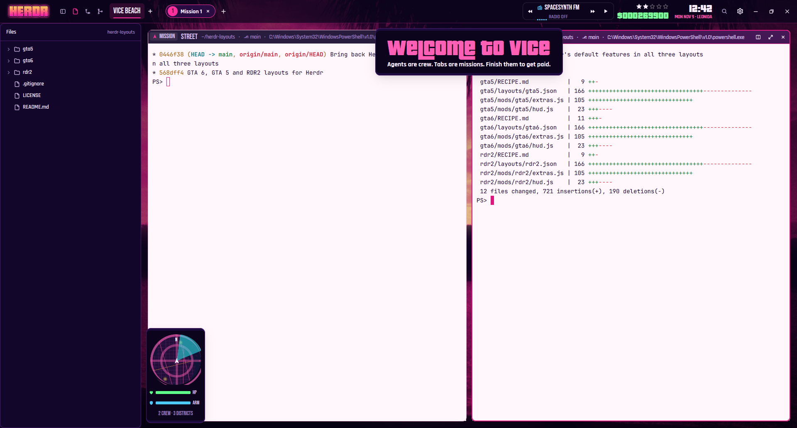

# GTA 6

A neon Vice-City-at-sunset HUD for Herdr, inspired by GTA VI. Spaces are districts, tabs are missions, agents are your crew. A finished agent pays out with a gold "mission passed" banner. One that gets stuck lights up the wanted stars. A radio in the top bar streams free synthwave. The terminals sit on light pink glass over a palm-tree sunset.

Fan-made and unofficial. It contains no Rockstar art. The logo, banners, minimap and sounds were made for this layout, and the wallpaper is a public-domain photo.

## What you see

- **HUD, top, 56px**: `#0b041c` at 70% opacity over the wallpaper, with a 1px `#ff2f9c55` bottom line. It is a window-drag bar. From left to right:
  - **Logo:** `img/logo.png`, a "HERDR" wordmark in a sunset gradient, 110×40.
  - **Districts:** one chip per space, Bebas Neue 19px, uppercased.
    - The active chip has a `#ff2f9c26` background and a 2px pink underline.
    - A status dot follows the name, pulsing while working or blocked.
    - A `+` makes a new space.
  - **Missions:** the active space's tabs as 32px pills, radius 16.
    - Each pill has a numbered circle (pink when active) and the tab's name. An unnamed tab shows its agent's program, or "Mission N".
    - A status dot pulses: fast when blocked, slow when working.
    - A `+` opens Herdr's new-menu.
  - **Radio:** a 42px box with a station name in Bebas, five animated EQ bars in the station color, and a status line ("Synthwave · 45%", "TUNING…", "RADIO OFF", "NO SIGNAL"). ⏮ and ⏭ change station; ▶/■ plays or stops.
  - **Wanted stars:** five stars, with cash under them (Pricedown 24px, `#7dff9a`, `$000000000`).
  - **Clock:** Pricedown 26px, with a line under it in Rajdhani, e.g. "SAT NOV 7 · LEONIDA".
  - **Buttons:** Search (Herdr's picker), Settings (with a dot when an app update is ready), then minimize, maximize and close where the system draws no window buttons.
- **Panes**:
  - Pane frames: background `#fff7fbf0`, radius 10, gap 12, padding 16, a 1px `#e0167f40` border, and a 2px `#e0167f` border when focused.
  - Terminals: JetBrains Mono 14 on light pink (`themes/gta6.json`), opacity 0.94, so the sunset glows through faintly.
- **Pane header, 32px**:
  - The focused pane: a `#3a0d4cf2` background with an "ACTIVE MISSION" chip in pink. Other panes: `#12062ae6` with a "MISSION" chip.
  - Then the program name in Bebas ("STREET" for a shell), and the folder, branch and title in Rajdhani.
  - A status badge, then split, zoom and close buttons.
- **Radar** (floating, left edge, bottom):
  - A 128px round map: an invented coastline city in purple, navy and pink, with a crosshair and a cyan sweep that turns once every 3.6s.
  - Every agent is a blip; you are the white arrow in the middle.
  - Under it: an HP bar (green) and an ARM bar (cyan), and "N CREW · N DISTRICTS". It sits on its own dark card.
- **Banner** (floating, top center, hidden between banners): a dark card with `img/passed.png` ("mission passed"), `img/wanted.png` ("heat's on"), or the welcome line "welcome to vice" in Pricedown pink, with a Rajdhani line under it.
- **Wallpaper:** a public-domain Miami sunset with palms, recolored in neon (`img/wallpaper.jpg`, cover).

## How it behaves

- **Agent statuses:**
  - Working: gold `#ffd166` dots that pulse slowly. Each working agent lights one wanted star.
  - Blocked: red `#ff3b5c` dots that pulse fast. Each blocked agent lights two stars, and the lit stars flash red.
  - Done: green `#5dff8a`.
  - Idle: muted `#9a7fc0`.
- **Working → done:**
  - The cash goes up by a random $5,000–75,000, kept in shared `gta6.cash`.
  - `sounds/passed.mp3` plays.
  - The "mission passed" banner shows "<program> · <tab>   +$N" for 4.2s.
- **Becoming blocked:** `sounds/wanted.mp3` plays, and the "heat's on" banner shows "<program> in <space> needs you".
- **Entering the layout:** the welcome banner shows for 3.8s, and the radio starts unless you turned it off last time.
- **Leaving the layout:** the radio stops.
- **Clicks:**
  - Districts select their space; missions select their tab.
  - Middle-click a mission to close it; right-click for Herdr's tab menu.
  - Click a radar blip to focus that agent's pane.
  - Pane headers: double-click zooms, middle-click closes.
  - Click the logo for a little cash sound.
- **Radio:** six free nightride.fm streams: Nightride, Chillsynth, Datawave, Spacesynth, Darksynth and Rekt. Scroll over the radio to change the volume in steps of 5; the stream restarts 600ms after you stop scrolling. Station, volume and on/off are kept in shared `gta6.radio`.

- **Herdr's default features:** the HUD keeps what Herdr's own sidebar and tab bar do.
  - After the logo: buttons that open a side panel on the left (340px, hidden at first): **Spaces & agents** (Herdr's `spaces` and `agents` lists, stacked: machines, worktrees, pin, peek, sort, sub-agents), **Files** and **Changes** (`hud-files` and `hud-changes`, see Watch out). Click the lit one again to close the panel.
  - Districts and missions: drag one onto another to reorder, double-click to rename, middle-click to close (no confirm), right-click for Herdr's space or tab menu.
  - The active mission has a × to close it, and a zoomed mission reads "· Z" after its name.
  - It's all in `mods/gta6/extras.js`, the same file in every layout of this repo.

## Built from

- **Layout `layouts/gta6.json`:**
  - Under the HUD, a `work-body` row: a hidden `panel` column (a `panel-body` stack of `crew` [`spaces` + `agents` blocks], `files` (mod `hud-files`) and `changes` (mod `hud-changes`)), then `main`.
  - The root is a column: `hud` block, 56px, window_drag, mod `gta6` with `{role: "hud"}`; then the `main` tab block.
  - Pane header: mod `gta6` with `{role: "mission"}`, height 32.
  - Floats on `main`: `radar` (`{role: "radar"}`, left/end) and `banner` (`{role: "banner"}`, top/center).
  - Root settings: `titlebar: "none"`, `theme: "gta6"`, `ui_font: "Rajdhani"`, `background` set to the wallpaper image.
- **Mod `mods/gta6`:** one mod in roles. `main.js` dispatches to `hud.js`, `mission.js`, `radar.js` and `banner.js`; `kit.js` holds the colors, fonts, the radio and cash.
- **Theme `themes/gta6.json`:**
  - Terminals: light, with `background` and `colors.background` both `#fff7fb`.
  - Every other panel color stays dark, so menus and popups keep the night look.
- **Herdr API used:**
  - Data: `spaces()`, `agents()`, `panes()`, `shared`/`setShared`, `fonts()`, `window()`.
  - Commands: `space.select`, `space.new`, `space.move`, `space.rename`, `space.close`, `tab.select`, `tab.move`, `tab.rename`, `tab.close`, `layout.show`, `layout.hide`, `layout.select`, `mod.open`, `pane.focus`, `pane.split`, `pane.zoom`, `pane.close`, `app.settings`, `window.*`.
  - Other: `openOverlay` (Herdr's `new-menu` and `menu`), `playSound`, `hc`.
- **Programs:**
  - It runs `ffplay` (from FFmpeg) as a herdr-core terminal named `gta6-radio`, started with `hc run --bg --rm` and stopped with `hc kill gta6-radio`.
  - That terminal has no Herdr labels, so no screen shows it.
  - It reaches the network only for the radio streams (`https://stream.nightride.fm/<id>.mp3`).
- **Art:** the fonts are Bebas Neue and Rajdhani (both OFL, included). Pricedown is optional (see Watch out). The PNGs and MP3s were made for this layout; the wallpaper is a recolored public-domain Wikimedia Commons photo ("Gfp-florida-miami-sunset.jpg").

## Watch out

- **Copy `themes/gta6.json`** as well as the layout and the mod. Without it the terminals fall back to your default theme.
- **Pricedown isn't included:** its licence forbids redistribution. The live text (cash, clock, welcome line) uses Pricedown when it's installed, else Bebas Neue. For the full look, get it from Typodermic or DaFont and drop the `.otf` into `mods/gta6/fonts/`.
- **The radio needs `ffplay` on PATH.** On Windows it also tries winget's `%LOCALAPPDATA%\Microsoft\WinGet\Links`. Don't launch the player with `exec`: `exec` waits for the player's pipes, so it never returns while music plays. That's why it runs as an `hc` terminal.
- `image()` keeps an image's aspect ratio (there is no cover fit). Give images their real proportions.
- `toLocaleDateString` ignores options here, so dates are built by hand.
- Floating blocks are framed in the theme's `background`, which is the light terminal color here. The radar and banner draw their own dark card.
- Right-clicking a mission opens Herdr's shipped `menu` with `{tab: "tab", target: {id, space}}`.

- **Files and Changes are copies.** Herdr's shipped `files` and `changes` paint the theme's `background` under its `foreground`. In the GTA themes, `background` is the light terminal color and `foreground` is the dark panels' light text, so those panels would be unreadable. `mods/hud-files` and `mods/hud-changes` are the shipped mods with one change: they paint `chrome` when those two colors are too close. Copy both folders into `mods/`. They're the same in every layout of this repo.

## Done when

- `herdr-app check mods/gta6` passes, and `layout.switch {"name":"gta6"}` shows the HUD, pink pane headers, the radar bottom left and the welcome banner.
- Pressing ▶ plays music within about a second, and `hc ls` shows `gta6-radio`. ■ stops it, and switching layouts stops it too.
- When an agent goes from working to done, the cash goes up and "mission passed" shows. A blocked agent flashes the stars red and shows "heat's on".
- Clicking a radar blip focuses that agent's pane.
