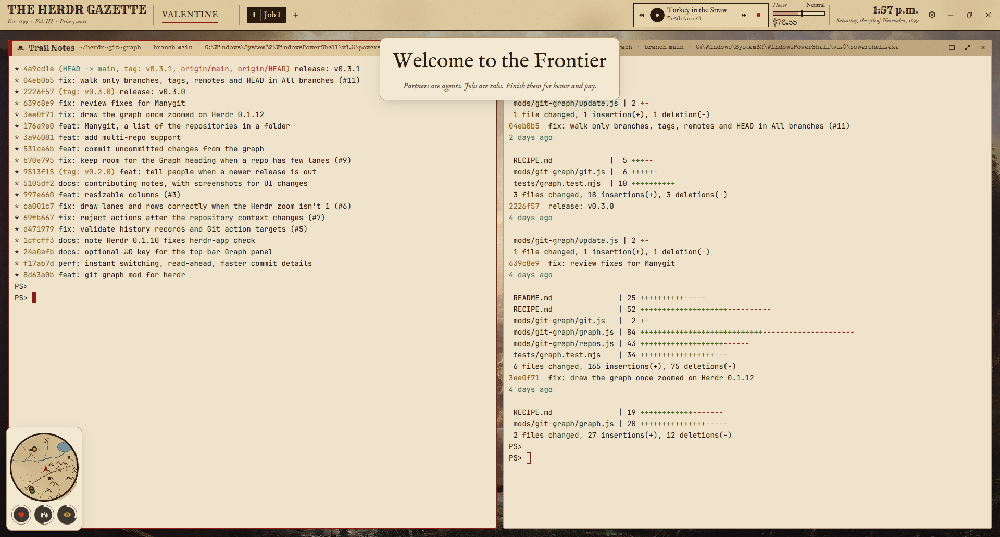

# RDR2

The frontier, 1899, inspired by Red Dead Redemption 2. The top bar is a parchment newspaper, *THE HERDR GAZETTE*. Spaces are towns, tabs are jobs numbered I, II, III, and agents are your partners. A phonograph plays public-domain records from 1901–1922. Honor rises as jobs get done. A partner stuck waiting goes up on a WANTED poster. Panes are journal pages on paper, with an Albert Bierstadt landscape behind them.

Fan-made and unofficial. It contains no Rockstar art: the painting and the records are public domain, and everything else was made for this layout.

## What you see

- **Masthead, top, 60px**: parchment (`img/masthead.jpg`, 3840×128, drawn larger than the bar and clipped), with a 2px `#2b1a0e` ink rule underneath. It is a window-drag bar. From left to right:
  - **Title:** "THE HERDR GAZETTE" in Rye 23px, over "Est. 1899 · Vol. <spaces in Roman numerals> · Price 5 cents" in IM Fell English italic 12px.
  - **Towns:** one per space, in IM Fell 17px uppercase. The active town is ink with a 2px blood-red `#8e1b14` underline; the others are faded `#8a6a48`. Each has a status dot. A `+` founds a new town.
  - **Jobs:** the active space's tabs as 30px tickets.
    - Each ticket starts with a Roman numeral in Rye.
    - The active ticket is inverted: ink background, paper text. The rest have an ink border on light paper.
    - A status dot follows the name. A `+` opens Herdr's new-menu.
  - **Phonograph:**
    - A black disc that spins while playing, the record's title in IM Fell, and the artist in Special Elite.
    - The status line also says "winding the crank...", "phonograph at rest" or "the needle skipped".
    - ⏮ and ⏭ change record; ▶/■ drops or lifts the needle.
  - **Honor and money:**
    - An honor meter, 100px: a white bar with a red left half and an ink marker that slides. A label reads Outlaw, Shady, Neutral, Decent or Honorable.
    - Under it, money in Special Elite, kept to the cent ("$76.55").
  - **Date:** the time in Rye ("1:43 p.m."), over the date in IM Fell italic: "Saturday, the 7th of November, 1899". The year is always 1899.
  - **Buttons:** Settings, then minimize, maximize and close.
- **Panes**:
  - Pane frames: paper `#efe4cbf0`, radius 3, gap 12, padding 16, a 1px `#5a3d2466` border, and a 2px blood-red border when focused.
  - Terminals: JetBrains Mono 14, in ink on paper (`themes/rdr2.json`).
- **Pane header, 30px**: a parchment strip, bright for the focused pane and darker for the others.
  - The focused one has a 6px red ribbon on the left.
  - Then a hat icon (or the program's icon), the name in Rye ("Trail Notes" for a shell), and the folder and branch in Special Elite.
  - Status shows as a rubber stamp: AT WORK, NEEDS YOU (flashing), DONE or RESTING.
  - Split, zoom and close buttons in ink.
- **Cores** (floating, left edge, bottom):
  - A 132px round, hand-inked map: rivers, a lake, mountains, a railroad, trails, towns. Agents are blips around a red arrow.
  - Under it, three cores (38px dark discs with a cream ring that fills in tenths):
    - Heart: partners not stuck.
    - Lungs: partners at work.
    - Eye: partners done.
- **Banner** (floating, top center):
  - "MISSION COMPLETE" in IM Fell, in white over a dark red brush stroke (`img/complete.png`).
  - Or a tilted WANTED poster (`img/poster.png`): the agent's name in Rye, "last seen in <space>", "for keeping a partner waiting", and "$N REWARD" in red.
  - Or news in IM Fell ("Welcome to the Frontier").
- **Wallpaper:** Albert Bierstadt, *Among the Sierra Nevada, California* (1868), public domain, warmed slightly (`img/wallpaper.jpg`).

## How it behaves

- **Statuses:**
  - Working: gold `#c99a3b`.
  - Blocked: red `#b3261e`, flashing.
  - Done: green `#5f7d3a`.
  - Idle: faded.
- **Working → done:** you earn $5.00–$80.00 (shared `rdr2.cents`) and honor +1 (shared `rdr2.honor`, −10 to 10). A plucked-guitar sting plays, and "MISSION COMPLETE" shows "<program> · <job>  +$N  Honor increased".
- **Blocked:** a bell-and-guitar sting plays, and the WANTED poster shows for 5s with a random reward of $50–$450.
- **An agent disappears mid-job:** honor −1, and "A partner has fallen" shows.
- **Phonograph:**
  - Records loop (`-loop 0`) until changed. Seven choices:
    - *Arkansaw Traveler* (Eck Robertson & Henry Gilliland, 1922).
    - *Maple Leaf Rag* (U.S. Marine Band, 1906).
    - *Turkey in the Straw*.
    - *Home on the Range*.
    - *Augustan Club Waltzes* (Scott Joplin, 1901).
    - *Kangaroo Hop* (Melville Morris, 1915).
    - "The Saloon Wire", streaming SomaFM's Boot Liquor live.
  - Scroll over it for volume.
  - It starts on entering the layout unless you turned it off, and stops on leaving.
- **Clicks:** the same as the GTA layouts. Towns select spaces and jobs select tabs; middle-click closes a job; right-click opens Herdr's tab menu. Click a blip to focus that agent's pane. Clicking the title shows an "Extra! Extra!" note.

## Built from

- **Layout `layouts/rdr2.json`:** a root column with the `hud` block (60px, window_drag, mod `rdr2` with role `hud`), then the `main` tab block with pane header role `mission`. Floats: `cores` (role `radar`, left/end) and `banner` (top/center). `theme: "rdr2"`, `ui_font: "IM FELL English"`.
- **Mod `mods/rdr2`:** `main.js` (roles), `hud.js`, `mission.js`, `radar.js`, `banner.js`, and `kit.js` (inks, fonts, the records list, money, honor, the phonograph).
- **Theme `themes/rdr2.json`:** a light paper theme, `#efe4cb` with ink `#2b1a0e`.
- **Programs:**
  - `ffplay`, run as the herdr-core terminal `rdr2-phono`.
  - It plays local files from `mods/rdr2/records/` (`appHome()` + path).
  - It reaches the network only for "The Saloon Wire".
- **Art:**
  - Fonts: Rye and IM Fell English (OFL), and Special Elite (Apache 2.0), all included.
  - Records: public-domain recordings from Wikimedia Commons, converted to mono 96k MP3.
  - Made for this layout: the parchment, poster, brush stroke, map, core rings (`icons/ring-0..10.svg`), icons and stings.

## Watch out

- Copy `themes/rdr2.json` too.
- **`image()` keeps aspect ratio.** The masthead and journal strips are drawn as 3840×128 and 1920×80 images inside `overflow_hidden` boxes, so they cover any width without gaps at the sides.
- `toLocaleDateString` ignores its options here, so build weekday and month names by hand.
- ffplay must be on PATH, or in winget's Links folder on Windows.
- The banner sits on the theme's paper background, so its text is ink.

## Done when

- `herdr-app check mods/rdr2` passes, and the layout shows the parchment masthead with towns, jobs and the 1899 date, the paper panes, and the cores bottom left.
- ▶ plays *Arkansaw Traveler*, the disc spins, and `hc ls` shows `rdr2-phono`.
- A finished agent shows MISSION COMPLETE and moves the honor marker right. A blocked agent shows the WANTED poster.
